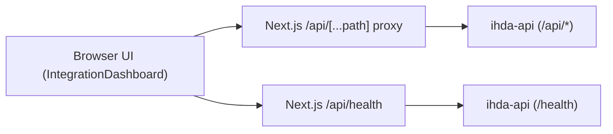

# ihda-web: Integration Health Dashboard

Next.js App Router, React, and TypeScript dashboard with a same-origin API proxy for the Integration Health Dashboard. This repository runs locally as the frontend and BFF proxy service alongside `ihda-api` in a two-repository Simple SOA layout.

## Architecture overview



Directory structure:

- `src/app/page.tsx` and `src/app/layout.tsx`: Entry page and document metadata.
- `src/app/globals.css`: High-contrast light theme, focus indicators, status badge styles, and responsive two-column grid.
- `src/app/api/[...path]/route.ts`: Same-origin proxy forwarding `GET` and `POST` requests, `cookie`, `authorization`, `set-cookie`, and `x-request-id` headers between browser and `ihda-api`.
- `src/app/api/health/route.ts`: Web health endpoint checking both Next.js readiness and upstream `ihda-api` reachability.
- `src/components/IntegrationDashboard.tsx`: Dashboard state machine, venue filters, stale banner, job table, detail panel, bounded polling, and race protection.
- `src/components/StatusBadge.tsx`: Accessible status pills pairing SVG icons with uppercase text labels.
- `src/lib/api-client.ts`: Typed fetch wrapper and `ApiError` parser.
- `src/lib/format.ts`: Explicit UTC timestamp formatter (`formatUtcTimestamp`).
- `src/lib/types.ts`: Shared frontend discriminated unions and DTO interfaces.
- `src/components/__tests__/IntegrationDashboard.test.tsx`: Vitest and React Testing Library unit and component tests.
- `e2e/dashboard.spec.ts`: Playwright end-to-end suite covering all five required scenarios.

## Prerequisites and local setup

Requirements to run locally without Docker:

- Node.js 22 and npm 10.
- Available TCP port `3000` (configurable via `PORT`).
- A running `ihda-api` instance reachable at `API_BASE_URL` (defaults to `http://localhost:4000`).

Use the same verification and run commands across local setup and CI (`.github/workflows/ci.yml`):

```bash
cp .env.example .env
npm ci
npm run typecheck
npm run lint
npm test
npm run build
npm run start
```

For local development with hot reload:

```bash
npm run dev
```

To run the Playwright end-to-end suite (install Chromium once, then let `playwright.config.ts` start both built `ihda-api` and `ihda-web` servers):

```bash
npx playwright install chromium
npm run test:e2e
```

Open `http://localhost:3000`. Health endpoint: `GET /api/health`.

## Select synthetic sessions and stub modes

The top header provides a labeled `Session` selector that writes the `ihda_session` cookie through `POST /api/session`:

- `operator-A (Tenant A · Operator)`: Bootstrapped automatically on a clean browser session. Lists `j1` (`A1`) and `j2` (`A2`) and enables retry controls.
- `viewer-A (Tenant A · Viewer)`: Lists `j1` and `j2`, removes retry buttons from the UI, and relies on server-side `403` rejection for direct API calls.
- `operator-B (Tenant B · Operator)`: Lists only `j3` (`B1`, `Mock Reservations`) and isolates tenant `B` from tenant `A`.
- `Signed Out (401 test)`: Clears the session cookie to display the `401` banner and the `Sign in as operator-A` recovery button.

The `Stub Mode` bar below the header drives deterministic backend testing without editing code:

- `Normal`: Resets delay, forced errors, and never-complete flags. Normal retries resolve to `HEALTHY` after two `GET /api/jobs/:id` polls.
- `Delay (A1)`: Configures `delayMs: 1200` scoped to `delayVenueId: "A1"` so switching from `A1` to `A2` demonstrates in-flight race protection.
- `Forced 500`: Sets `force500Remaining: 1` and immediately triggers a refresh so the `500` error banner and stale data view appear together. Clicking `Retry Load` recovers cleanly.
- `Never-Complete`: Sets `neverComplete: true` so retried jobs stay `QUEUED` past the UI polling limit.
- `Reset Fixtures`: Calls `POST /api/stub/reset`, cancels active polling loops, and reloads clean `j1..j3` data.

To test URL parameter manipulation in the browser, open `http://localhost:3000/?venueId=B1` while signed in as `operator-A`. The server returns `403 Forbidden`, and the UI offers `Reset to Permitted Venues`.

## UI states, accessibility, and race handling

- **Semantic controls and contrast:** Uses native `<header>`, `<main>`, `<aside>`, `<table>`, `<dl>`, `aria-pressed` buttons, `role="status"` and `role="alert"` announcements, visible `:focus-visible` outlines, and responsive stacking below `920px`.
- **Non-color status indicators:** `StatusBadge` pairs distinct SVG icons (cross, clock, checkmark) with uppercase `FAILED`, `QUEUED`, and `HEALTHY` text.
- **Explicit UTC timestamps:** `formatUtcTimestamp` in `src/lib/format.ts` renders `YYYY-MM-DD HH:mm:ss UTC` or `Never (no successful sync)` when `lastSuccessAt` is `null`.
- **Stale state during refresh or failure:** When `jobs` already holds successful data, refreshing or encountering a `500` error keeps the last-known table visible under a `Refreshing latest status` or `Showing stale data` banner with a `Retry Load` action. Switching sessions clears previous tenant state first so stale tenant `A` rows never appear under tenant `B`.
- **Venue-switch race protection:** `jobsRequestSeqRef` assigns a monotonic sequence number to every list request and `jobsAbortRef` aborts superseded requests with `AbortController`. Late `A1` responses cannot overwrite an active `A2` view.
- **Duplicate retry prevention:** `retryInFlightRef` tracks in-flight job IDs synchronously before `await`, immediately disabling `Retry` and `Retry Sync` buttons on click. If a `409 Conflict` returns from the API, the UI aligns the row to `QUEUED` without starting a duplicate submission.
- **Bounded polling:** `IntegrationDashboard` polls `GET /api/jobs/:id` every `POLL_INTERVAL_MS` (`350ms`) up to `MAX_POLL_ATTEMPTS` (`5`). On `neverComplete`, polling stops at check 5, displays `Unresolved sync state` without claiming success, and exposes a read-only `Check Status Again` button.

## Demonstration transcript

1. Open `http://localhost:3000`. The dashboard loads as `operator-A` and shows `j1` (`A1`, `Mock POS`, `FAILED`, `2026-11-23 09:00:00 UTC`) and `j2` (`A2`, `Mock HR`, `HEALTHY`, `2026-11-24 01:00:00 UTC`). Tenant `B` job `j3` is not shown.
2. Click `A1`, then click `Retry` on `j1`. The row immediately displays `QUEUED`, polls `/api/jobs/j1` twice, and transitions to `HEALTHY` with an updated UTC timestamp.
3. Switch `Session` to `viewer-A`. Both `Retry` and `Retry Sync` disappear, replaced by a read-only notice. Sending `POST /api/jobs/j1/retry` directly returns `403` and leaves `j1` unchanged.
4. Visit `/?venueId=B1` as `operator-A`. The banner reports `Access forbidden (403)` with `Reset to Permitted Venues`. Switch `Session` to `operator-B` to view `j3` (`B1`, `Mock Reservations`, `Never (no successful sync)`).
5. Switch back to `operator-A`, click `Reset Fixtures`, and click `Forced 500`. The error banner appears alongside the stale data banner while `j1` and `j2` remain visible; clicking `Retry Load` recovers.
6. Click `Never-Complete` and retry `j1`. Polling stops after 5 checks, explains that the job is still `QUEUED`, and keeps `Check Status Again` available.
7. Click `Reset Fixtures`, click `Delay (A1)`, click `A1`, and immediately click `A2`. `Mock HR` stays visible after the delayed `A1` window elapses. Click `All (A1, A2)` and double-click `Retry` on `j1`; only one `POST /api/jobs/j1/retry` request is sent.

## Automated tests

- **Unit and component tests (`npm test`):** Runs 4 Vitest and React Testing Library tests in `src/components/__tests__/IntegrationDashboard.test.tsx`, covering UTC formatting, `viewer-A` read-only UI, empty job lists, stale data during delayed refresh, and `401` signed-out recovery.
- **Playwright E2E tests (`npm run test:e2e`):** Runs 5 end-to-end scenarios in `e2e/dashboard.spec.ts` against real `ihda-api` and `ihda-web` servers (`workers: 1` because fixtures live in shared API memory):
  1. Happy path: operator views authorised jobs, filters by `A1`, retries `j1`, and observes `QUEUED` then `HEALTHY`.
  2. Viewer enforcement: `viewer-A` sees no retry controls and direct `POST /api/jobs/j1/retry` returns `403` without mutating `j1`.
  3. Tenant isolation: `operator-A` is blocked via URL parameter `/?venueId=B1` and direct API calls to `venueId=B1` and `j3` (`403`), while `operator-B` views `j3`.
  4. Fault and recovery: `Forced 500` keeps stale data visible and recovers on `Retry Load`; `Never-Complete` stops polling at the cap without claiming success.
  5. Race conditions: delayed `A1` never overwrites `A2`, and double-clicking `Retry` issues exactly one `POST` request.

Latest verified run: `npm run typecheck`, `npm run lint`, `npm test` (4 of 4 Vitest tests passed), `npm run build`, and `npm run test:e2e` (5 of 5 Playwright tests passed in 16.1s) exited with code `0`.

## Implemented and unfinished requirements

| Area | Status | Notes |
| --- | --- | --- |
| Accessible dashboard, UTC timestamps, venue filter, detail and error view | Implemented and verified | Verified in Vitest and Playwright |
| Loading, empty, stale, `401`, `403`, and `500` recovery states | Implemented and verified | Stale banner preserves last-known jobs across refreshes and `500` errors |
| Bounded polling, `neverComplete` handling, and double-click or race guards | Implemented and verified | Sequence IDs + `AbortController` + synchronous `Set<string>` lock |
| Vitest component suite (4 tests) and Playwright E2E suite (5 tests) | Implemented and verified | All 9 tests passed after final edits |
| Health endpoint and GitHub Actions CI workflow | Implemented | CI workflow uses identical npm commands |
| Docker local packaging | Removed by request | Configured to run directly with local Node.js 22 |

## Design note, assumptions, and trade-offs

- **Same-origin API proxy:** Routing browser requests through `src/app/api/[...path]/route.ts` keeps cookies (`ihda_session`) and fetch calls on a single origin (`localhost:3000`), avoiding CORS cookie issues in local development while keeping `ihda-api` on a separate service boundary.
- **Client-side bounded polling vs SSE or WebSockets:** Polling `GET /api/jobs/:id` up to 5 times at `350ms` intervals matches the stub's two-poll completion model with predictable resource caps and no persistent socket state. In production, longer-running syncs would switch to exponential backoff or server-sent events backed by queue worker updates.
- **Assumptions:** On initial load without an existing cookie, the UI signs into `operator-A` so reviewers land directly on an active tenant view rather than a blank login gate. Selecting `Signed Out (401 test)` explicitly tests unauthenticated behavior.
- **Known limitation:** `playwright.config.ts` sets `workers: 1` because `ihda-api` stores fixture state in memory; running Playwright workers in parallel would cause tests to reset each other's fixtures mid-run.

## Deployment note

- **Environment variables:** Defined in `.env.example`.

| Variable | Default | Purpose |
| --- | --- | --- |
| `PORT` | `3000` | HTTP port bound by Next.js |
| `API_BASE_URL` | `http://localhost:4000` | Internal server-side URL for `ihda-api` |

- **Secret handling:** No secrets are embedded in client bundles or committed files. `API_BASE_URL` is read only on the Next.js server inside `route.ts`, and `ihda_session` cookies remain `HttpOnly` and `SameSite=Lax`.
- **Health checks:** `GET /api/health` responds `200` with `{ status: "ok", service: "ihda-web", apiHealthy }` after probing `${API_BASE_URL}/health` with a 2-second timeout.
- **Logging:** Next.js writes server logs to `stdout`. The proxy preserves and forwards `x-request-id` returned by `ihda-api` so UI errors can be correlated with backend logs.
- **Rollback:** Built deterministically from `package-lock.json` via `npm ci` and `npm run build`. Roll back `ihda-web` independently of `ihda-api` by redeploying the previous Git commit or build artifact.

## Time spent and attribution

- **Time spent:** Approximately 25 minutes for AI-assisted implementation and automated verification of `ihda-api` and `ihda-web` (add your own manual review and walkthrough preparation time before final submission).
- **AI and third-party libraries:** Built and verified with Antigravity and OpenBot coding assistance. Uses Next.js, React, React DOM, TypeScript, Vitest, React Testing Library, Playwright, jsdom, and ESLint.
